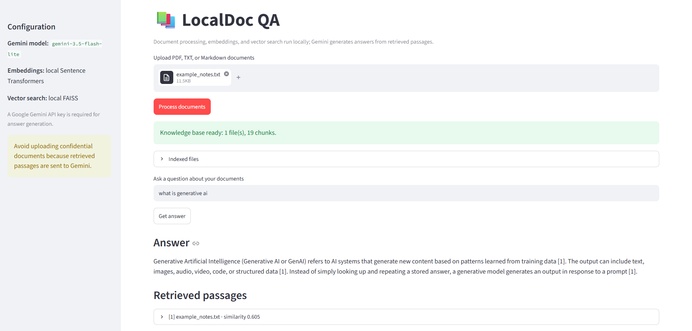

# LocalDoc QA

A small RAG application that answers questions from user-uploaded PDF, TXT, and Markdown files. It displays retrieved evidence and uses a fallback when no passages pass the retrieval threshold.

<p align="center">
  
</p>

## Architecture

- `app.py`: Streamlit interface only
- `rag/document_loader.py`: extract text and source/page metadata
- `rag/chunking.py`: overlapping text chunks
- `rag/embeddings.py`: local Sentence Transformers embeddings
- `rag/vector_store.py`: local FAISS index
- `rag/retriever.py`: top-k retrieval and distance threshold
- `rag/generator.py`: Gemini answer generation
- `rag/pipeline.py`: orchestration
- `rag/config.py`, `rag/schemas.py`: settings and data structures

Document processing, embeddings, and vector search run locally. The question and retrieved passages are sent to Gemini for generation. Do not upload sensitive documents. Check current Gemini API terms and free-tier quotas.

## Setup (Windows PowerShell)

1. Get an API key from https://aistudio.google.com/apikey.
2. Copy `.env.example` to `.env` and add your key:

```powershell
Copy-Item .env.example .env
```

Edit `.env` so `GOOGLE_API_KEY` contains your key. Never commit `.env`.

3. Create environment and install dependencies:

```powershell
uv venv
.venv\\Scripts\\Activate.ps1
uv pip install -r requirements.txt
```

If activation is blocked:

```powershell
uv pip install --python .venv\\Scripts\\python.exe -r requirements.txt
```

4. Run:

```powershell
streamlit run app.py
```

Or without activation:

```powershell
uv run --python .venv\\Scripts\\python.exe streamlit run app.py
```

Open the local URL shown in the terminal, usually http://localhost:8501.

## Usage

1. Upload PDF, TXT, or Markdown files.
2. Click **Process documents**.
3. Ask a question.
4. Inspect the answer and expand the retrieved passages to see source filenames and PDF page numbers.
5. Ask something absent from the documents and verify the fallback.

PDFs must contain selectable text. Scanned PDFs need OCR first.

## Design decisions and limitations

- Local embeddings and FAISS keep vector search on-device and avoid paid embedding APIs.
- Gemini is used for answer generation, so no local chat model is needed.
- The FAISS index exists in Streamlit session state and is rebuilt after refresh.
- FAISS distance threshold is heuristic and may need tuning. It can exclude relevant passages or retain weak matches.
- The prompt encourages evidence-only answers but cannot guarantee correctness. Verify important claims against the passages.
- OCR, persistent indexing, and automated evaluation are outside this minimal version.
- Gemini free-tier availability, quotas, and terms can change.

## Example questions

Use `sample_documents/example_notes.txt`:
- What are the five stages of a RAG pipeline?
- What does chunk overlap do?
- What is the capital of Japan? (Not answered in the sample document.)
